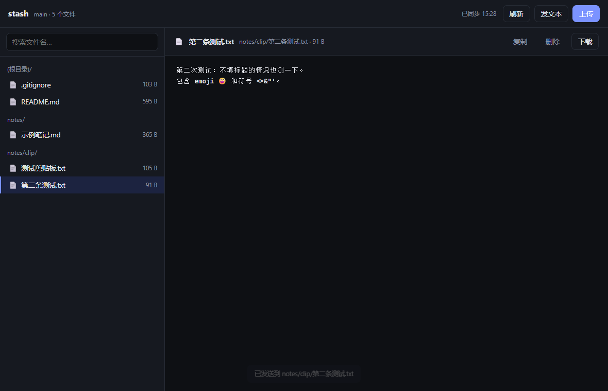

# stash-client

把任意一个 **private GitHub 仓库**变成两台电脑之间的暂存区：只拉文件清单，不下载内容；文本直接在窗口里读；要用的文件点一下才下载。



## 解决什么问题

两台电脑，其中一台不常开机。想给它留点东西（文档、代码片段、课件、一段文字），又不想开 U 盘、不想让两台机器同时在线。

做法：把东西丢进一个 private GitHub 仓库，另一台机器打开这个客户端——

- **只看清单**：文件名、目录、大小，不占本地磁盘
- **文本直接读**：`.md` / `.txt` / `.json` / 代码文件在右边直接显示，还能一键复制
- **按需下载**：真正要用的那个文件才下载
- **随手传**：拖文件进来，或者点「发文本」粘贴一段话

## 特性

- 只调 `git/trees` 拿元数据，**不 clone、不下载文件内容**
- 文本预览（≤512 KB），等宽字体、保留换行
- 一键下载（本机服务代理，token 不暴露给浏览器）
- 上传：点选或拖拽；文本自动进 `notes/`、其他进 `files/`
- 「发文本」：粘贴 → `Ctrl+Enter` → 存成 `notes/clip/<标题>.txt`
- 预览右上角「复制」，一键取走全文
- 每 30 秒自动刷新清单，深色/浅色跟随系统
- 纯 Python 标准库，**零第三方依赖**

## 快速开始

### 方式一：下载 exe

从 [Releases](../../releases) 下载 `stash-client.exe`，双击运行。首次启动会弹配置面板，填四样东西：

| 字段 | 说明 |
| --- | --- |
| GitHub 用户名 | 比如 `octocat` |
| 仓库名 | 自己新建一个 **private** 空仓库，比如 `stash` |
| 分支 | 默认 `main` |
| Personal Access Token | 见下 |

### 方式二：源码运行

```bash
python app.py
```

需要 Python 3.10+。没有 pip 依赖。

### 生成 Token

打开 <https://github.com/settings/tokens?type=beta>，新建一个 **fine-grained token**：

- Repository access：只选那个暂存仓库
- Permissions → Contents：**Read and write**

配置会写到程序同目录的 `config.json`，只在本机使用。

## 仓库结构建议

```
inbox/      随手丢，回头再整理
notes/      文本、笔记（客户端里可直接预览）
files/      其他文件
```

客户端不强制结构，任何路径都能列出来。

## 工作原理

```
浏览器  ──fetch──▶  127.0.0.1:8902  ──Bearer token──▶  GitHub REST API
                   (Python http.server)
```

| 动作 | GitHub 接口 |
| --- | --- |
| 列清单 | `GET /repos/{owner}/{repo}/git/trees/{branch}?recursive=1` |
| 读文本 | `GET /repos/{owner}/{repo}/contents/{path}` |
| 上传 / 覆盖 | `PUT /repos/{owner}/{repo}/contents/{path}` |
| 删除 | `DELETE /repos/{owner}/{repo}/contents/{path}` |
| 下载 | 代理 `raw.githubusercontent.com` |

token 只存在 Python 进程里，前端拿不到。

## 已知限制

- 单文件 **100 MB**（GitHub 硬上限），超过请换网盘
- 文本预览上限 512 KB
- GitHub 的 tree API 有 1–3 秒缓存，刚上传的文件在清单里会慢半拍（客户端会自动重试几次）
- 仓库虽然是 private，内容依然存在 GitHub 上，**不要放密钥、证件照片**
- 只支持 GitHub，不支持 Gitee/GitLab（接口不同，改起来不难）

## 打包

```bat
build.bat
```

需要 `pip install pyinstaller`，产物在 `dist\stash-client.exe`（约 9 MB，单文件）。

## License

MIT
